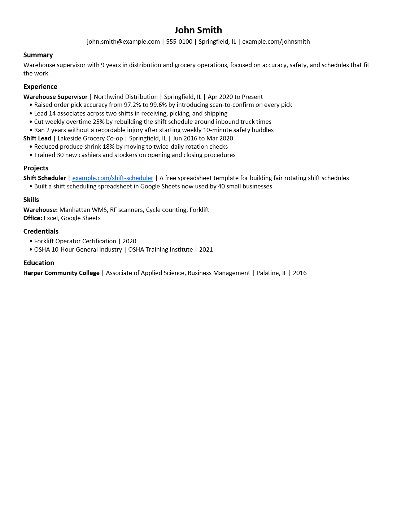
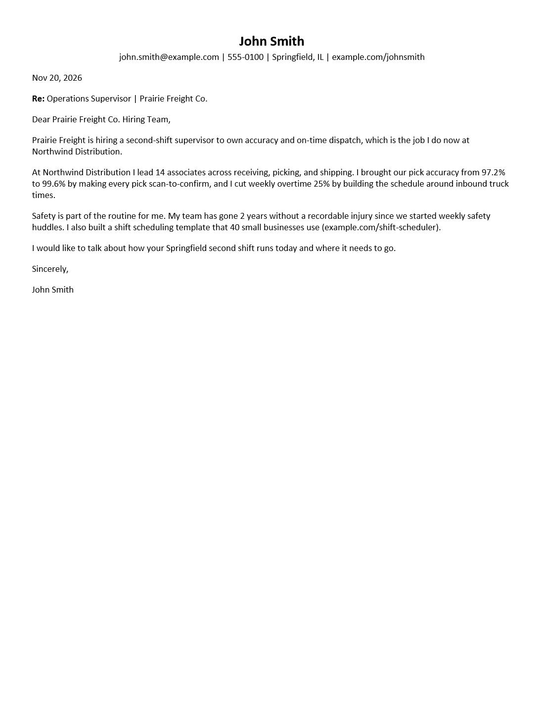

# Jobforge

[](https://pypi.org/project/jobforge/)
[](https://github.com/jesse-anderson/jobforge/actions/workflows/tests.yml)
[](https://github.com/jesse-anderson/jobforge/actions/workflows/tests.yml)
[](https://www.python.org/downloads/)
[](https://github.com/jesse-anderson/jobforge/blob/main/LICENSE)
[](https://github.com/jesse-anderson/jobforge#what-you-need)
[](https://github.com/jesse-anderson/jobforge/blob/main/pyproject.toml)

Turn your real work history into a resume and cover letter tailored to one
job posting, on your own computer, for free, without the tool ever stating a
fact you did not give it.

**Status: 0.1.0, the first release.** It works end to end on Windows and
Linux. Expect rough edges, and please report them.

- **Free and local.** Nothing runs on a server. Your AI coding agent (Claude
  Code first; Codex, Gemini CLI and others also work) does the writing, and
  Jobforge does everything else.
- **No invented facts.** Every number written in digits, and every employer,
  tool, and credential Jobforge knows, is checked against facts you
  confirmed. If your agent invents one, Jobforge refuses to write the
  document. It does not catch everything yet, so read what it writes; see
  the [known limits](https://github.com/jesse-anderson/jobforge/blob/main/docs/MVP.md#known-limits-of-the-fact-check).
- **Built for applicant tracking systems.** It writes `.docx` files with no
  tables, columns, or hidden characters, then reads them back to prove what a
  parser will see.

Source-available under [PolyForm Noncommercial 1.0.0](https://github.com/jesse-anderson/jobforge/blob/main/LICENSE): free for personal use
and for nonprofits, schools, and public institutions. Not for commercial use.

## What you get

A one-page resume and cover letter for one posting, as `.docx` files. These
are for John Smith, a made-up warehouse supervisor applying to a made-up
operations job, built from the [sample data](https://github.com/jesse-anderson/jobforge/tree/main/fixtures/personas/john_smith)
and shown as Word opens them. Every figure in them comes from a fact he
confirmed.

| Resume | Cover letter |
|---|---|
| [](https://github.com/jesse-anderson/jobforge/blob/main/docs/samples/resume.png) | [](https://github.com/jesse-anderson/jobforge/blob/main/docs/samples/cover_letter.png) |

## What you need

- Windows or Linux (macOS is untested).
- Python 3.11 or newer. Check with `python3 --version` on Linux, or
  `python --version` on Windows.
- An AI coding agent that runs in a terminal, such as Claude Code.

## Set up (once)

On Linux, install with pipx. Ubuntu, Debian, and others block `pip` for the
system Python, and pipx is how they want apps like this one installed:

```
sudo apt install pipx
pipx ensurepath                 # then open a new terminal
pipx install jobforge           # or: git clone, then `pipx install .`
jobforge init ~/jobsearch
```

On Windows:

```
pip install jobforge            # or: git clone, then `pip install .`
jobforge init ~/jobsearch
```

No internet where you install? Each release on
[GitHub Releases](https://github.com/jesse-anderson/jobforge/releases) has
an offline bundle, `jobforge-offline-X.Y.Z.zip`, with a `SHA256SUMS` to
check it against. Unzip it and run `sh install.sh` (Linux) or
`powershell -ExecutionPolicy Bypass -File install.ps1` (Windows); both check
the wheel before installing. By hand, from the unzipped folder:
`python -m pip install --no-index --find-links ./wheels jobforge`.

That makes a folder with everything Jobforge needs:

```
jobsearch/
  CLAUDE.md, AGENTS.md   instructions for your agent (generated)
  profile/profile.toml   your name and contact details
  profile/atoms/         your confirmed facts
  profile/pending/       facts your agent drafted, waiting for you
  intake/                put your old resume here
  jobs/                  one folder per job you apply to
```

1. Copy your old resume (and any cover letters) into `intake/`.
2. Open your agent in the `jobsearch` folder and say **"set me up"**. It reads
   your resume, fills in your profile, and drafts your facts into
   `profile/pending/`. Where your resume is unclear, it asks.
3. Run **`jobforge confirm`**. For each drafted fact, you choose keep, drop,
   or skip. Only facts you keep are ever used.

To remove Jobforge later, `pipx uninstall jobforge` (Linux) or
`pip uninstall jobforge` (Windows). Your `jobsearch` folder stays as it is.

## Apply to a job

Tell your agent: **"apply to this job: <link>"** (or paste the posting). It
will:

1. `jobforge prepare --from-url <link>` to save the posting,
2. write a plan for which facts to use and how to word them,
3. `jobforge check <job>` until the plan passes,
4. `jobforge apply <job>`, which writes `Your_Name_Resume.docx` and
   `Your_Name_Cover_Letter.docx` into the job's folder.

Read both documents, then upload the `.docx` files yourself. `cover_letter.md`
is a working copy for review; never send it.

When you have applied: `jobforge applied --mark <job> --status applied`.
Record later news the same way (`screen`, `interview`, `offer`, `rejected`,
...). `jobforge jobs` lists everything; a job with no reply after 30 days shows
as **ghosted**.

## Bring in past applications

Already applied to jobs before Jobforge? Put them in a CSV (your agent can
make one from your tracker) and import them, so `jobforge jobs` lists them and
`prepare` warns you before applying to the same posting twice.

```
company,title,location,url,applied,status,status_date,notes
Prairie Freight Co.,Operations Supervisor,"Springfield, IL",https://example.com/jobs/1,2026-09-02,rejected,2026-09-20,
Cedar Mill Foods,Shift Supervisor,"Decatur, IL",,2026-09-10,applied,,
```

`company`, `title`, and `applied` are required. Write dates as YYYY-MM-DD. A
status after `applied` (`screen`, `interview`, `rejected`, ...) needs the date
it happened in `status_date`; if you do not know it, import the row as
`applied` and record the rest later with `jobforge applied`.

1. `jobforge import past.csv` shows what each row will become and writes
   nothing. Check it.
2. `jobforge import past.csv --write` creates the job folders. Running it again
   skips rows already imported. It also finishes an import that was stopped
   partway, and adds a status a row has gained in your tracker since, as long
   as you have not recorded anything for that job in Jobforge. The preview
   shows these as FINISH.

Imported jobs hold only what happened: no posting text, plan, or documents.

## Commands

| Command | Does |
|---|---|
| `jobforge init <folder>` | Make a workspace (`--refresh` regenerates the agent files) |
| `jobforge confirm` | Review drafted facts: keep, drop, or skip |
| `jobforge inventory` | List your confirmed facts |
| `jobforge prepare --from-url <url>` | Save a posting (or `--from-text <file>` with `--company` and `--title`) |
| `jobforge check <job>` | Check a plan without writing documents |
| `jobforge apply <job>` | Check, then write the resume and cover letter |
| `jobforge applied --mark <job> --status <stage>` | Record what happened |
| `jobforge jobs` | List your jobs and their status (`search` works too) |
| `jobforge import <file.csv>` | Preview past applications from a CSV; `--write` imports them |

`<job>` is the job folder's name or any unique piece of it.

## Optional extras

Not needed to use Jobforge. Planned for later releases:

- **PDF output** (via Tectonic). Upload the `.docx` meanwhile; it is the
  format applicant tracking systems read most reliably.
- **A progress page** showing applications over time, callback rate, and
  outcomes.

## For maintainers

```
pip install -e ".[dev]"
python -m pytest                 # also works uninstalled: pytest finds src/
python -m coverage run -m pytest && python -m coverage report
```

- `docs/COMPONENTS.md`: what each part is called and where it lives
- `docs/MVP.md`: what the first public release does, and build status
- `docs/DECISIONS.md`: every scope decision; the governing record
- `docs/SOW.md`: phases to 1.0
- `docs/MAINTAINING.md`: how work is assigned and merged
- `CONTRIBUTING.md`: issues welcome; outside PRs closed until the regression
  harness exists (D-19)
- `SECURITY.md`: how to report a problem that could expose a user's data
- `docs/VM_CHECKLIST.md`: the clean-machine check before every release
